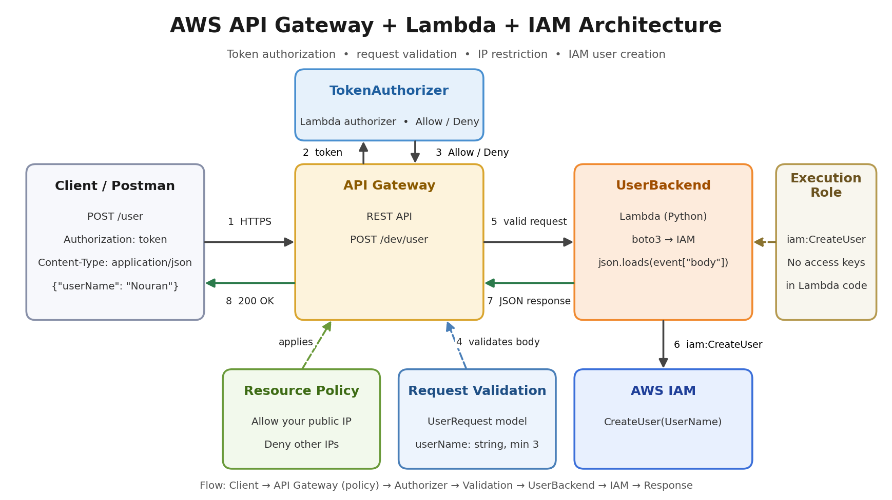
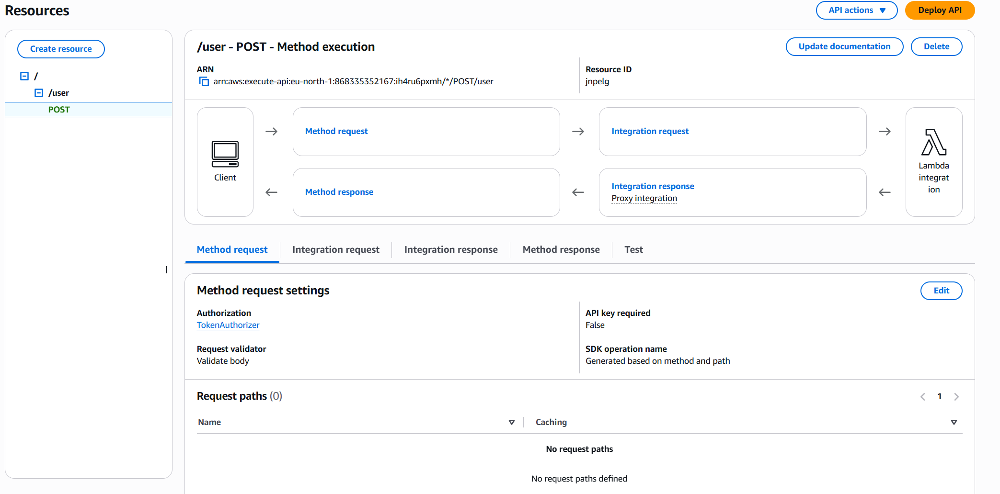
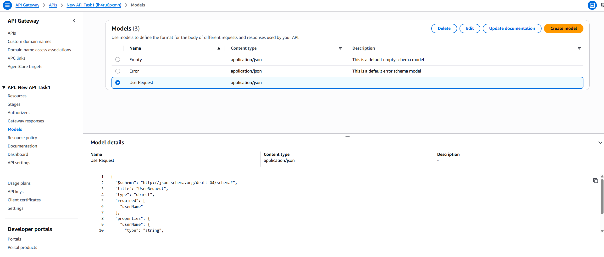
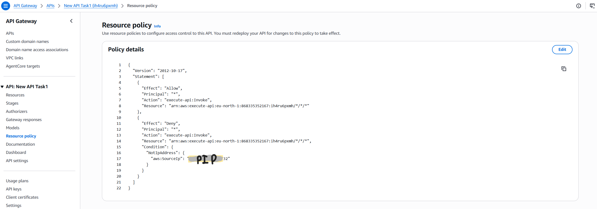
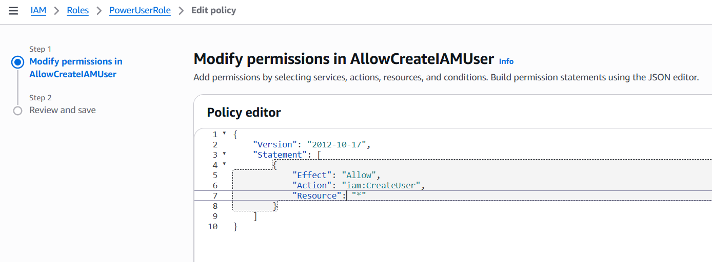
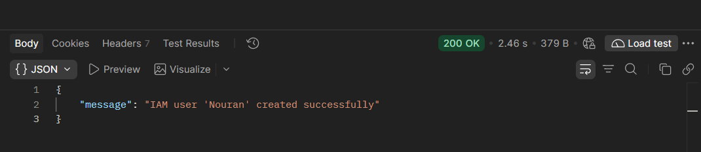
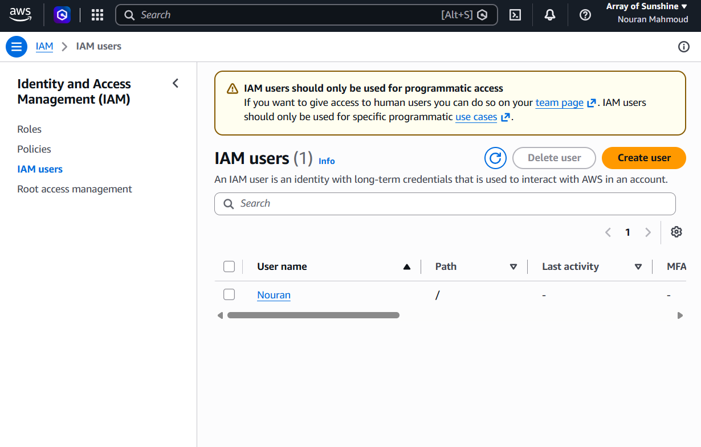
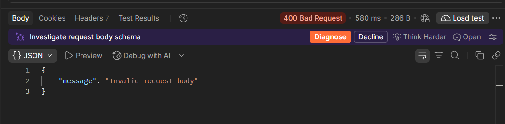
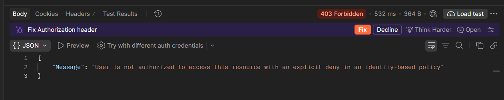

# AWS API Gateway IAM User Creation API

A serverless REST API built with Amazon API Gateway and AWS Lambda that authorizes requests using a token-based Lambda authorizer, validates the request body using an API Gateway model, restricts API access by source IP, and programmatically creates an IAM user through the AWS IAM API.

## Architecture



### Request Flow

1. The client sends a `POST /user` request to Amazon API Gateway.
2. API Gateway applies the resource policy to restrict access by source IP.
3. API Gateway invokes the `TokenAuthorizer` Lambda.
4. The authorizer validates the provided authorization token.
5. API Gateway validates the request body against the `UserRequest` model.
6. The request is forwarded to the `UserBackend` Lambda.
7. The backend extracts the requested username.
8. The backend uses Boto3 to call the AWS IAM `CreateUser` API.
9. AWS IAM creates the requested IAM user.
10. The Lambda returns a JSON response through API Gateway.

---

## AWS Services Used

- Amazon API Gateway
- AWS Lambda
- AWS IAM
- Amazon CloudWatch Logs
- Boto3 / AWS SDK for Python

---

## API Endpoint

### API Gateway Method Configuration



The API is deployed to the `dev` stage.

```text
POST /dev/user
```

Example:

```text
https://<api-id>.execute-api.<region>.amazonaws.com/dev/user
```

The deployed endpoint is intentionally represented with placeholders in this repository rather than exposing account-specific deployment information.

---

## API Request

### Headers

```http
Authorization: <token>
Content-Type: application/json
```

### Request Body

```json
{
  "userName": "Nouran"
}
```

---

## Request Validation

The API Gateway request model requires:

- `userName` to be present
- `userName` to be a string
- `userName` to contain at least 3 characters

**Example valid request:**

```json
{
  "userName": "Nouran"
}
```

**Example invalid request:**

```json
{
  "userName": "Al"
}
```

The second request fails the `minLength: 3` validation rule.

### Request Model




---

## Token Authorization

The API uses a Lambda token authorizer. The authorizer receives the authorization token from the request and determines whether the request should be allowed.

For this educational implementation, a test token is used.

> **Note:** The token-based authorizer in this project is intended for learning and demonstration purposes. A production authentication system should use a secure identity and token management solution.

---

## API Gateway Resource Policy

The API Gateway resource policy restricts access based on the source IP address.

The policy:

- Allows API invocation at the resource-policy level.
- Explicitly denies requests originating from IP addresses outside the configured allowed IP.
- Uses `execute-api:Invoke`.

The actual public IP is intentionally not committed to this repository.

 

---

## Backend Lambda

The `UserBackend` Lambda receives the validated request and extracts the username:

```python
body = json.loads(event["body"])
user_name = body["userName"]
```

It then creates the IAM user using Boto3:

```python
iam = boto3.client("iam")
iam.create_user(
    UserName=user_name
)
```

Finally, it returns a JSON response:

```json
{
  "message": "IAM user 'Nouran' created successfully"
}
```

---

## IAM Permissions

The Lambda executes using an IAM execution role. The role requires permission to call:

```text
iam:CreateUser
```

The permission is granted to the Lambda execution role rather than storing AWS credentials or access keys inside the Lambda source code. This follows the AWS IAM role-based approach for Lambda execution.

 

---

## Example Response

For a successful request:

 

---

## Testing

The API was tested using Postman.
**Postman result:**


**IAM user created in the AWS Console:**

 

### Test 2 — Username Too Short




### Test 3 — Invalid Authorization Token




### Test 4 — Unauthorized IP

Requests originating from an IP outside the configured resource policy should be denied by API Gateway.

---

## Error Handling and Debugging

During development, an initial Lambda invocation produced:

```text
KeyError: 'body'
```

The error occurred because the Lambda expected the API Gateway Lambda proxy event format to contain a `body` field.

The API Gateway integration configuration was investigated and corrected so that the Lambda receives the expected request event.

CloudWatch Logs were used to investigate Lambda execution errors.

---

## Repository Structure

```text
aws-api-gateway-iam-user-api/
│   
├── README.md  
│   
├── architecture/  
│   └── aws-architecture.png  
│   
├── docs/  
│   ├── api-gateway-method.png  
│   ├── api-gateway-policy.png  
│   ├── request-model.png  
│   ├── lambda-permissions.png  
│   ├── iam-user-created.png  
│   └── postman-success.png  
│  
├── lambda/  
│   ├── token-authorizer/  
│   │   └── lambda_function.py  
│   │
│   └── user-backend/  
│       └── lambda_function.py  
│  
├── api-gateway/  
│   ├── user-request-model.json  
│   └── resource-policy.json   
│  
├── iam/  
│   └── lambda-create-user-policy.json  
│  
└── .gitignore  
```

---

## Security Notes

This repository intentionally does not contain:

- AWS access keys
- AWS secret access keys
- passwords
- private credentials
- the actual public IP used by the resource policy
- account-specific secrets

AWS credentials should never be committed to a Git repository.

The Lambda accesses AWS services through its IAM execution role rather than through hardcoded credentials.

---

## Technologies

- Python
- Boto3
- AWS Lambda
- Amazon API Gateway
- AWS IAM
- Amazon CloudWatch
- REST API
- JSON